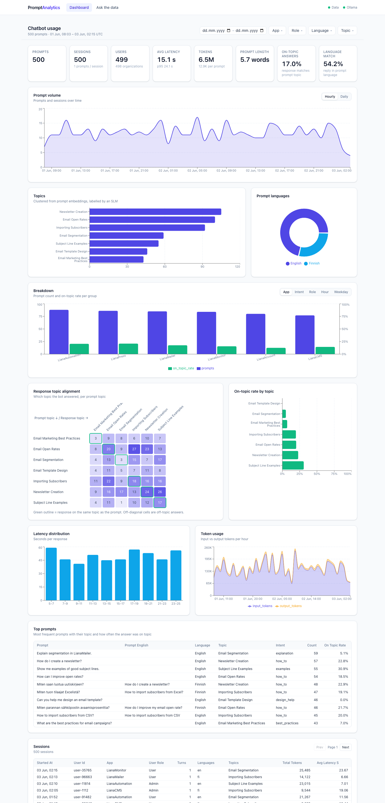
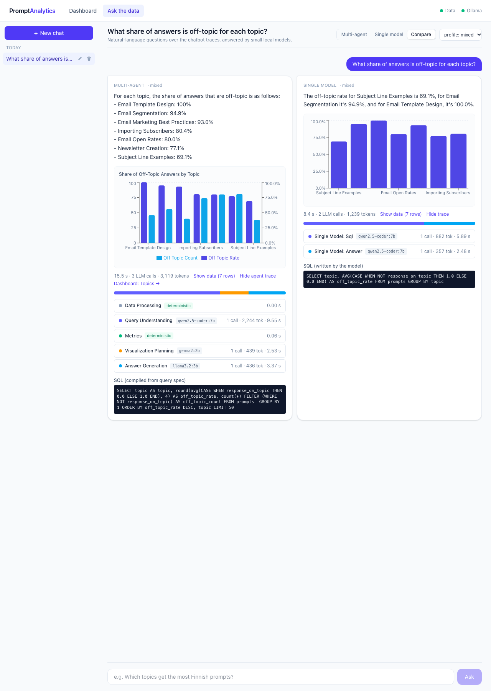
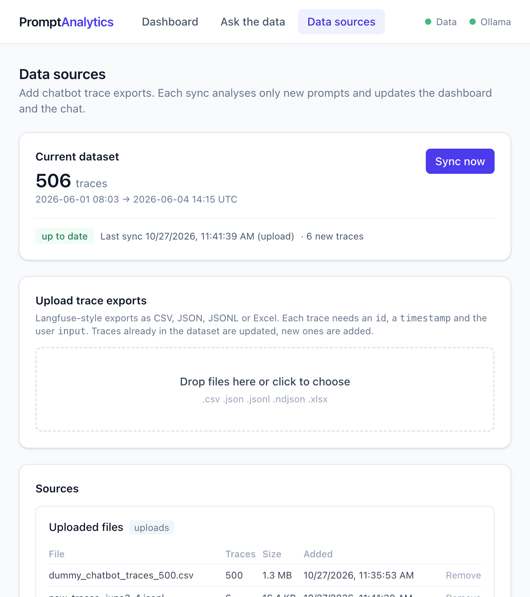

# SLM-based Multi-Agent Systems for Interactive Prompt Analytics

Thesis prototype (Tampere University). It turns raw chatbot trace exports into

- a **dashboard** with predefined views of chatbot usage, and
- a **chat interface** where customers ask questions about the data in natural language,

answered by a **multi-agent system of small language models (SLMs)** running locally on Ollama, with a
**single-model baseline** and an **evaluation harness** for comparing the two.



## Repository layout

| Path | Contents |
|---|---|
| `backend/app/data/` | Loading, cleaning and feature extraction from trace CSVs into DuckDB |
| `backend/app/metrics/` | Deterministic dashboard metrics |
| `backend/app/mas/` | Query spec, the five agents, the orchestrator and the model profiles (`config.yaml`) |
| `backend/app/baseline/` | Single-model text-to-SQL baseline |
| `backend/app/data/sources.py` | Data sources: uploads, watched folders, background sync |
| `backend/app/api/` | FastAPI app (`/api/dashboard/*`, `/api/chat`, `/api/chats/*`, `/api/data/*`) |
| `backend/eval/` | Evaluation questions, runner, scorer and report generator |
| `backend/tests/` | Unit tests for the deterministic parts |
| `frontend/` | React + Vite + Recharts + Tailwind UI |
| `data/` | Your trace exports, the generated DuckDB file and caches (not committed); `data/samples/` holds a small demo export |
| `docs/` | Architecture, design decisions, evaluation notes |

## Quick start

Requirements: Python 3.12+ with [uv](https://docs.astral.sh/uv/), Node 20+, [Ollama](https://ollama.com).

```bash
# 1. Models (about 14 GB in total)
ollama pull llama3.2:3b && ollama pull gemma2:2b && ollama pull qwen2.5-coder:7b \
  && ollama pull llama3.1:8b && ollama pull nomic-embed-text

# 2. Data: put the trace export at data/dummy_chatbot_traces_500.csv (or set MAS_RAW_CSV),
#    or skip the pipeline step and upload exports on the Data sources page later
cd backend
uv sync
uv run python -m app.data.pipeline        # builds data/analytics.duckdb (about 40 s first time, cached afterwards)

# 3. API
uv run uvicorn app.api.main:app --port 8000 --reload --reload-dir app

# 4. UI (new terminal)
cd frontend && npm install && npm run dev  # http://localhost:5173
```

## Run with Docker (demo)

The API and the UI run in containers. Ollama stays on the host: Docker on macOS cannot use the Apple GPU, so models inside a container would run on the CPU only and be several times slower.

Requirements: Docker Desktop, and Ollama running on the host with the models pulled (step 1 above, or pull them later from the Models page).

```bash
docker compose up -d --build   # http://localhost:8080 (set WEB_PORT to change it)
docker compose logs -f api     # follow the API log
docker compose down            # stop; the data stays in ./data
```

- `./data` on the host is mounted at `/data` in the API container, so the database, uploads, saved chats, SLM caches and model profiles are shared with a local (non-Docker) run. Stop the local dev servers before starting the containers so that two servers do not sync the same data.
- To use a watched folder, put it under `data/` (for example `data/watch/exports`) and add it on the Data sources page as `/data/watch/exports`. Folders elsewhere on the host need an extra volume in `docker-compose.yml`.
- The API runs as a single worker on purpose: sync, folder checks, model downloads and chat memory live in that process.
- To use Ollama on another machine, set `OLLAMA_URL` (for example `OLLAMA_URL=http://gpu-box:11434 docker compose up -d`).
- There is no login. Keep the demo on localhost or a trusted network; anyone who can open the page can upload data and download or delete models.

## Using the chat

The chat opens from the round button in the bottom-right corner of every page, so you can ask questions while looking at the dashboard. The conversation stays open as you move between pages and after a reload. In the chat panel, the clock icon lists recent chats, **+** starts a new one, and the expand icon opens the full chat page (`/chat`), which adds the chat sidebar and the profile selector.

The chat has three modes. **Multi-agent** uses the agent pipeline, **Single model** uses the baseline, and **Compare** asks both and shows the answers side by side.
The profile selector picks which models power the agents (see `backend/app/mas/config.yaml`):

| Profile | Query understanding | Visualization | Answer | Baseline |
|---|---|---|---|---|
| `small` | llama3.2:3b | llama3.2:3b | llama3.2:3b | llama3.2:3b |
| `tiny` | gemma2:2b | gemma2:2b | gemma2:2b | gemma2:2b |
| `mixed` (default) | qwen2.5-coder:7b | gemma2:2b | llama3.2:3b | qwen2.5-coder:7b |

The chat header shows which model each agent uses for the selected profile. To change them, open the **Models** page (`/models`). It lists the installed Ollama models (size, parameters, quantization, whether they are in memory and which profiles use them). On that page you can **Customize** a built-in profile: choose a model for each agent and for the single model, save the result as a new profile, and make it the default. The built-in profiles stay as in `config.yaml`, so evaluation runs remain reproducible. Custom profiles are stored in `data/model_settings.json` (or `MAS_MODEL_SETTINGS`) and apply from the next question, without a restart. New models can be downloaded on the same page. The page detects whether Ollama is installed and running, and you either type any name from the [Ollama library](https://ollama.com/library) or pick a suggested small model. The download runs in the background with a progress bar, and the model is then available in the profile editors. Models no profile uses can be deleted there to free disk space. The data-processing and embedding models are set in `config.yaml`, because changing them re-analyses the whole dataset.

Every answer shows its result table and chart, a link to the related dashboard section, and an agent trace. The trace lists each step's model, latency and token count, plus the SQL that was run.

Chats are saved automatically, like in other chat apps. The sidebar lists them by date and lets you search, rename and delete them, and each chat has its own URL (`/chat/<id>`). Conversations are stored in `data/chats.sqlite` (or `MAS_CHATS_DB`). Reopening a chat, even after a server restart, restores its follow-up context.



## Adding and updating data

The **Data sources** page (`/data`) manages what the dashboard and the chat analyse. There are two ways to add data.

- **Upload** Langfuse-style trace exports as CSV, JSON (a list, or `{"data": [...]}`), JSONL or Excel. The file is validated first: each trace needs an `id`, a `timestamp` and the user `input`. The page shows how many of its traces are new, then a sync runs in the background.
- **Watch a folder** where exports are dropped, for example by a scheduled Langfuse export or a synced drive. New or changed files are imported on the chosen interval (5 or 15 minutes, hourly or daily) or on **Sync now**.

A sync rebuilds the database from all imported files. Traces are deduplicated by `id`, so a newer export of the same trace replaces the older one. The language-model features are cached per distinct text, so only new prompts cost model calls: adding six traces with two new prompts takes about 8 s. New prompts can form new topics. The new database is built next to the old one and swapped in when it is ready. If the build fails, for example because Ollama is not running, the current data stays in place and the error is shown in the sync history. The dashboard reloads automatically after a sync, and the chat uses the new data and date range from its next question.

On first start the existing `data/dummy_chatbot_traces_500.csv` is registered as an uploaded file, so the setup above keeps working. Imported files are kept in `data/sources/`, and the registry and sync history are in `data/sources.sqlite`. Removing a file or a source triggers a sync without its traces. Removing every file empties the dataset; the dashboard and the chat then point to the Data sources page. The bundled CSV is registered only on the very first start, so it does not come back after a restart. `data/samples/new_traces_june3-4.jsonl` is a small export for trying out incremental updates.



## Evaluation

```bash
cd backend
uv run python -m eval.run_eval                          # every profile, MAS and baseline
uv run python -m eval.run_eval --profiles small --repeat 3
uv run python -m eval.report eval/results/<run>         # rebuild tables and plots
```

Each run writes `results.jsonl`, `summary.md`, CSV tables, plots and a `ratings_template.csv` for manual usefulness ratings to `backend/eval/results/<run>/`.
See [docs/evaluation.md](docs/evaluation.md) for the method and the results of the reference run. In short, with 2 to 3B models the MAS answers 79 to 83% of the 53 questions correctly, against 55 to 59% for the baseline. With a 7B coder model both reach 96 to 98%, and the MAS is slower because the models are swapped in and out of memory.

The screenshots in `docs/screenshots/` can be regenerated with `node frontend/scripts/chat-screenshot.mjs docs/screenshots/chat.png`, with the API and the dev server running.

## Tests

```bash
cd backend && uv run pytest && uv run ruff check app eval tests
cd frontend && npm run lint && npm run build
```

## Configuration

| Variable | Default | Purpose |
|---|---|---|
| `MAS_RAW_CSV` | `data/dummy_chatbot_traces_500.csv` | Trace export to load |
| `MAS_DB_PATH` | `data/analytics.duckdb` | Feature database |
| `MAS_PROFILE` | `default_profile` in `config.yaml` | Default model profile |
| `OLLAMA_URL` | `http://localhost:11434` | Ollama server |
| `MAS_GROUND_FILTERS` | `mas_options.ground_filters` in `config.yaml` (on) | Set to `0` to switch off filter grounding, for the ablation |

Further reading: [architecture](docs/architecture.md), [design decisions and data findings](docs/design-decisions.md), [evaluation](docs/evaluation.md).
