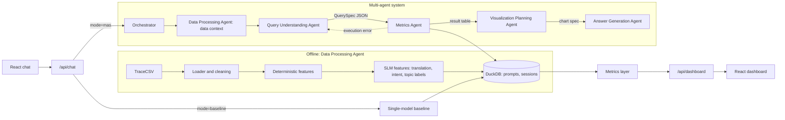
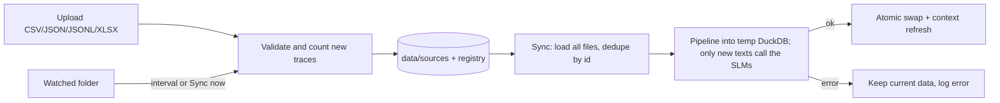

# Architecture

## Overview



## Data layer (`backend/app/data`)

- **`loader.py`** reads Langfuse-style trace exports. It unwraps rows where the whole CSV line is quoted into a single field (as in the dummy data), then parses the JSON columns `input` (the message history), `output`, `metadata` and `usage`, and returns one flat row per trace.
- **`features.py`** adds features in two groups.
  - Deterministic: time buckets, prompt and response lengths, and language (via langdetect, preferring the expected languages en/fi/sv).
  - SLM-derived, cached per distinct text and model in `data/cache/slm_features.json`:
    1. English normalisation and intent class for each distinct prompt.
    2. English translation of each distinct response.
    3. Topic clusters: agglomerative clustering over `nomic-embed-text` embeddings of the normalised prompts, with a cluster label written by the SLM.
    4. Response topic: the nearest topic centroid to each response. This yields `response_on_topic` and `response_similarity`.
- **`store.py`** writes the `prompts` and `sessions` tables to DuckDB and serves read-only cursors. `replace_database` swaps in a newly built file. It waits for running queries to finish and closes the old connection first, because DuckDB shares one database instance per path within a process.
- **`context.py`** builds the *data context* that every language model receives: the schema, the known categorical values, the date range and the meaning of "today". It is cached and cleared after every sync.
- **`sources.py`** manages data sources and updates.
  - A SQLite registry (`data/sources.sqlite`) records the sources, the imported files (with sha256 hashes to skip duplicates) and the sync runs.
  - There are two source kinds: uploads, and watched folders with a sync interval.
  - A sync scans the watched folders and loads all files in import order, deduplicating by trace id (the last file wins). It then runs the pipeline into a temporary DuckDB file with strict SLM features, so a model failure aborts the sync instead of writing placeholder labels. Finally it swaps the file in and clears the data context. Only one sync runs at a time; requests that arrive during a sync are queued to run after it.
  - A scheduler thread, started with the API, checks the watched folders every 30 s against their intervals.



## Metrics and dashboard (`backend/app/metrics`, `frontend/src/pages/Dashboard.tsx`)

All dashboard numbers come from deterministic SQL and can be filtered by date, app, role, language and topic. The dashboard sections are `overview`, `volume`, `topics`, `quality`, `latency_tokens`, `prompts` and `sessions`. The Visualization Planning Agent links chat answers to these sections.

## Multi-agent system (`backend/app/mas`)

Agents share a `SharedContext` (blackboard) that the orchestrator passes along. Each agent is a class with one `act()` method and an optional model taken from the active profile. Every call is recorded as an `AgentStep` with its model, latency, token counts, number of LLM calls, output and error.

| Agent | Model at query time | Input | Output |
|---|---|---|---|
| Data Processing | none (the SLM runs offline) | — | data context (schema, values, range) |
| Query Understanding | profile `query_understanding` | question, history, data context | validated `QuerySpec` or out-of-scope |
| Metrics | none (deterministic tool agent) | `QuerySpec` | SQL and result table |
| Visualization Planning | profile `visualization_planning`; skipped for single values and lists | question, spec, result preview | chart spec and dashboard section |
| Answer Generation | profile `answer_generation` | question, spec description, result preview | short grounded answer |

### Query spec (`query_spec.py`)

The interface between language understanding and computation is a small typed JSON language:

```json
{"kind": "aggregate", "metrics": ["avg_latency"], "group_by": ["app"],
 "filters": [{"field": "prompt_language", "op": "eq", "values": ["fi"]}],
 "start": "yesterday", "end": "yesterday", "order": "desc", "limit": 1}
```

- **Constrained decoding.** The Ollama `format` parameter receives a JSON schema with enums for the metrics, dimensions and filter fields, so the model can only emit names that exist.
- **Validation.** Pydantic validates the spec. If validation fails, the error goes back to the model, with up to 3 attempts.
- **Normalisation.** Filter values are snapped to values that exist in the data (case, substring, fuzzy match, language names to codes). Wildcards are dropped, `date` filters become the time range, `today` and `yesterday` are resolved, and the ordering is fixed for time series.
- **Grounding.** `ground_filters` drops filter values that the question and conversation never mention, using per-value vocabulary built from the data. This includes topic words in English and Finnish. It can be turned off with `mas_options.ground_filters`.
- **Compilation.** `compile_sql` emits parameterised SQL, so the model never writes SQL and user text never reaches the query string.

### Orchestration and recovery

`data_processing → query_understanding → metrics → visualization_planning → answer_generation`

- If the Metrics Agent fails to execute the spec, the error goes back to the Query Understanding Agent once.
- If visualization planning fails or proposes an invalid chart, the system falls back to the deterministic chart rules in `viz_rules.py`.
- If answer generation fails, the system returns the table instead.
- Conversation memory keeps the last 3 turns (question and spec), so follow-up questions can modify the previous spec.

## Baseline (`backend/app/baseline/single_model.py`)

One model with the same data context writes DuckDB SQL directly. The SQL is checked (single SELECT or WITH statement, no DDL or DML) and run on a read-only connection, with one repair attempt on errors. The same model then writes the answer using the same answer instructions as the Answer Generation Agent. Charts come from the deterministic rules. The only difference from the MAS is the task decomposition and the typed query interface.

## API

| Endpoint | Purpose |
|---|---|
| `GET /api/health` | Database and Ollama status, available profiles |
| `GET /api/dashboard/filters` | Filter options and data range |
| `GET /api/dashboard/{summary, volume, breakdown/{dim}, histogram/{col}, tokens, top-prompts, topic-alignment, sessions}` | Dashboard data; all accept the filter query parameters |
| `POST /api/chat` | `{question, mode: mas or baseline, profile?, conversation_id?}` returns the answer, table, chart, SQL, spec and steps |
| `GET /api/traces/{id}` | A stored chat response with all agent steps |
| `DELETE /api/conversations/{id}` | Clear the conversation memory |
| `GET /api/chats`, `GET/PATCH/DELETE /api/chats/{id}` | Saved chat sessions |
| `GET /api/data/status` | Rows, date range, data version and the latest sync |
| `GET /api/data/sources`, `GET /api/data/syncs` | Sources with their files; sync history |
| `POST /api/data/upload` | Multipart file upload; validates, stores and starts a sync |
| `POST /api/data/sources`, `PATCH/DELETE /api/data/sources/{id}` | Add, configure or remove a watched folder |
| `DELETE /api/data/files/{id}` | Remove an imported file and resync |
| `POST /api/data/sync` | Start a sync (queued if one is running) |
| `GET /api/models` | Installed and loaded Ollama models, all profiles with their per-role models, the default profile |
| `PUT/DELETE /api/models/profiles/{name}` | Create, update or delete a custom profile (built-in profiles are read-only) |
| `PUT /api/models/default` | Choose the default profile |
| `POST /api/models/pull`, `GET /api/models/pulls`, `DELETE /api/models/pulls/{name}` | Download a model through Ollama in the background, follow its progress, cancel it |
| `DELETE /api/models/installed/{name}` | Delete a model no profile uses |

Every chat response is also appended to `data/logs/chat_traces.jsonl`.
