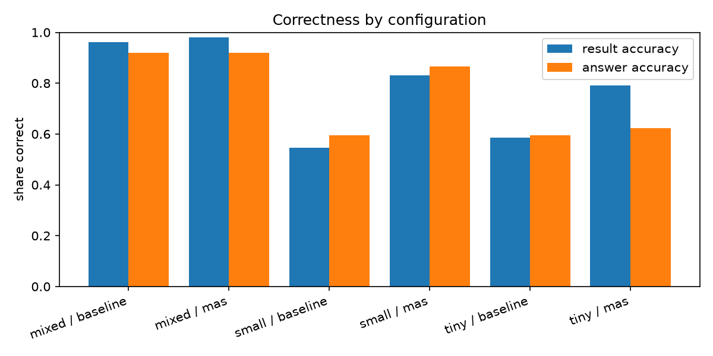
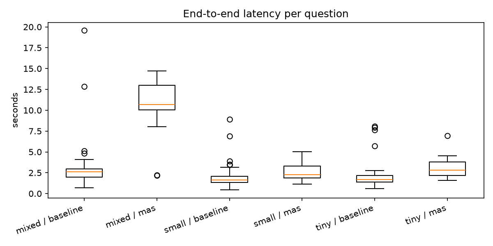

# Evaluation

This compares the five-agent SLM system (MAS) with the single-model text-to-SQL baseline on correctness, latency, resource use and maintainability (RQ3, RQ4, RQ6, RQ7). All numbers come from `backend/eval/results/<run>/summary.md`, produced by the commands at the end of this page.

## Method

**Questions.** `backend/eval/questions.yaml` holds 53 questions with hand-written gold SQL in ten categories: count, aggregate, ranking, breakdown, time, quality (topic alignment, language match), list, multilingual (Finnish), follow-up (two-turn conversations) and out-of-scope. Some questions have several acceptable answers (`accept_sql`), for example when two apps tie.

**Configurations.** Each of three model profiles runs in both modes:

| Profile | Query understanding / SQL | Visualization | Answer | Baseline model |
|---|---|---|---|---|
| `tiny` | gemma2:2b | gemma2:2b | gemma2:2b | gemma2:2b |
| `small` | llama3.2:3b | llama3.2:3b | llama3.2:3b | llama3.2:3b |
| `mixed` | qwen2.5-coder:7b | gemma2:2b | llama3.2:3b | qwen2.5-coder:7b |

The baseline always uses the strongest model of its profile for both of its calls.

**Metrics.**
- *Result accuracy*: the returned table matches the gold result. Depending on the question, the scorer checks a scalar value, a set of rows, row order, the top row, or a subset (for lists). For out-of-scope questions it checks that the system refused.
- *Answer accuracy*: the gold value appears in the natural-language answer. Percent and fraction forms are both accepted.
- *Faithfulness*: the share of numbers in the answer that also occur in the result table. Low values indicate hallucinated numbers.
- *Latency*: end-to-end time per question, plus *model load time*, the part Ollama spends loading weights.
- *Cost*: LLM calls, tokens, retry rate and peak Ollama memory (`/api/ps`).
- *Maintainability*: lines of code, functions, branches and prompt size per component (`eval/code_metrics.py`).

**Procedure.** Before each configuration all models are unloaded, then a warm-up question is answered and not scored. Decoding is deterministic: temperature 0 and a fixed seed. Hardware: Apple M5 laptop with 16 GB unified memory, Ollama 0.32.

## Results

Final run (`iteration2`):

| Profile | Mode | Result acc. | Answer acc. | Faithfulness | Errors | Mean latency | Model load | LLM calls | Tokens | Peak memory |
|---|---|---|---|---|---|---|---|---|---|---|
| tiny | baseline | 0.585 | 0.595 | 0.910 | 15% | 2.18 s | 0.20 s | 1.98 | 1,444 | 1.9 GB |
| tiny | MAS | **0.792** | 0.622 | 0.943 | 0% | 3.06 s | 0.24 s | 2.38 | 3,016 | 1.9 GB |
| small | baseline | 0.547 | 0.595 | 0.912 | 4% | 1.98 s | 0.21 s | 2.08 | 1,323 | 2.5 GB |
| small | MAS | **0.830** | 0.865 | 0.953 | 0% | 2.51 s | 0.22 s | 2.13 | 2,603 | 2.5 GB |
| mixed | baseline | 0.962 | 0.919 | 0.959 | 0% | 3.05 s | 0.15 s | 1.94 | 1,205 | 4.7 GB |
| mixed | MAS | **0.981** | 0.919 | 0.950 | 0% | 11.03 s | 3.66 s | 2.19 | 2,624 | 4.7 GB |



Result accuracy by category:

| Category | tiny base | tiny MAS | small base | small MAS | mixed base | mixed MAS |
|---|---|---|---|---|---|---|
| count | 0.78 | 0.89 | 0.67 | 1.00 | 1.00 | 0.89 |
| aggregate | 0.57 | 0.57 | 0.43 | 0.86 | 0.86 | 1.00 |
| ranking | 0.71 | 0.57 | 0.86 | 0.71 | 1.00 | 1.00 |
| breakdown | 0.50 | 1.00 | 0.50 | 0.67 | 1.00 | 1.00 |
| time | 0.50 | 0.83 | 0.50 | 0.83 | 1.00 | 1.00 |
| quality | 0.60 | 0.60 | 0.40 | 0.80 | 1.00 | 1.00 |
| list | 1.00 | 1.00 | 0.67 | 0.67 | 1.00 | 1.00 |
| multilingual | 0.67 | 1.00 | 0.33 | 0.67 | 0.67 | 1.00 |
| follow_up | 0.00 | 1.00 | 0.50 | 1.00 | 1.00 | 1.00 |
| out_of_scope | 0.33 | 0.67 | 0.33 | 1.00 | 1.00 | 1.00 |

### Findings

1. **With 2 to 3B models, the MAS is much more accurate than the baseline.** Result accuracy is +21 points for `tiny` and +28 points for `small`. The baseline's typical errors are structural:
   - invented columns, which cause the 15% execution errors for gemma2;
   - `COUNT(DISTINCT ...)` instead of `COUNT(*)`;
   - SQLite date functions in DuckDB;
   - added filters nobody asked for;
   - answering out-of-scope questions with a random query.

   The typed QuerySpec rules these out by construction, and the MAS has no execution errors.
2. **With a 7B coder model, the baseline is nearly as good.** For `mixed`, the gap shrinks to 0.981 vs 0.962, which is one question. A capable code model writes correct SQL for this schema. What the MAS adds at this size is control rather than accuracy: compiled SQL, refusal of out-of-scope questions, and handling of multilingual and follow-up questions that the baseline got partly wrong (multilingual 0.67).
3. **The MAS costs about twice the tokens and 0.5 to 1 s more latency**, mainly because the query understanding prompt (about 2,250 tokens, including the spec documentation and few-shot examples) is larger than the baseline's SQL prompt. The number of LLM calls is almost the same, about 2.1 versus 2.0, because the Metrics Agent and usually the Visualization Agent use no model.
4. **Faithfulness is higher for the MAS** in the small configurations (0.94 to 0.95 versus 0.91). The answer agent sees pre-formatted rates and a compact table.

### Latency and model swapping (RQ6)

The `mixed` MAS uses three different models per question. On a 16 GB machine, Ollama did not keep all three resident in the final run: peak memory was 4.7 GB, so only one model at a time. Each question then reloaded qwen2.5-coder:7b, which adds 3.7 s of load time, and lost the prompt cache, so the full 2,250-token prefix was processed again. In the ablation run below, under identical settings, Ollama happened to keep the models resident (peak 7.3 GB). The `mixed` MAS then averaged **5.97 s (median 3.9 s)** instead of 11.03 s, and query understanding took 4.3 s instead of 8.3 s.

So the heterogeneous profile's latency depends mostly on memory headroom, not on the agent design. Homogeneous profiles avoid swapping completely: `small` MAS answers in 2.5 s. For deployment, either set `OLLAMA_MAX_LOADED_MODELS` and leave enough memory, or use one model for all agents.



### Maintainability (RQ7)

| System | LOC | Functions | Branches | Prompt chars |
|---|---|---|---|---|
| Baseline | 118 | 3 | 15 | 605 |
| MAS (agents, orchestrator, QuerySpec) | 663 | 34 | 133 | 4,991 |
| Shared (data pipeline, LLM client, chart rules, schemas) | 776 | 54 | 121 | 753 |

The MAS is about 5.6 times the baseline's code. Most of it is `query_spec.py` (300 LOC): the metric and dimension catalogue, validation, normalisation, grounding and the SQL compiler. This is the price of the typed interface, but it is ordinary, unit-tested Python (24 tests) rather than prompt text. A new metric is one dictionary entry. Each agent can be swapped or given a different model through `config.yaml`. The agent trace in the UI shows which step failed, which the baseline's single SQL string doesn't.

## Iterations

The evaluation was run twice. The second iteration fixed problems found by inspecting the failures of the first. None of the changes touches the questions or gold answers, apart from tie-breaking explained below.

| Profile | MAS iteration 1 | MAS iteration 2 | Baseline (both) |
|---|---|---|---|
| tiny | 0.774 | 0.792 | 0.585 |
| small | 0.774 | 0.830 | 0.547 |
| mixed | 0.906 | 0.981 | 0.962 |

Changes between the iterations:

- **Gold ties.** Some ranking questions had tied values, so a correct answer could differ from the gold row order. The ranking gold SQL now has explicit tie-breakers, and r07 (top 2 apps by Finnish prompts) has an `accept_sql` alternative. Iteration 1 was rescored with the corrected gold (`eval/rescore.py`), so both columns use the same scoring. Five verdicts changed.
- **Few-shot examples as chat turns.** In iteration 1 the examples sat inside the system prompt as `Q:`/`A:` lines. qwen2.5-coder sometimes returned the spec of the *neighbouring* example, for example the "Finnish newsletter prompts" filters for "How many prompts were sent on June 2?". The examples are now sent as user/assistant message pairs.
- **Example leakage removed.** Two examples were near-paraphrases of evaluation questions ("prompts yesterday", "tokens on June 2"). One had also taught models to add a `user_role = User` filter, which they then copied into unrelated questions. These were replaced by examples using different metrics and dates (sessions yesterday, median latency on June 4) and one numeric filter example.
- **Schema fixes for constrained decoding.** Comparing constrained and free generation showed two places where the JSON schema pushed models into wrong output:
  - Filter values were string-only, so for "latency above 24 seconds" the model, which wanted to emit a number, produced an empty list. Values may now be numbers.
  - Unconstrained, qwen wanted a `date` filter. With that field missing from the enum, it fell back to an arbitrary field. `date` is now accepted and normalised into `start`/`end`.
- **Context window 8192 → 4096 tokens**, enough for every prompt here (the largest are about 2,500 tokens). It also reduces memory, which matters for keeping models resident.
- **Filter grounding** (see the ablation).

Iteration 2 fixed every `time` failure of the `mixed` MAS (0.5 → 1.0) and the latency list question. The remaining `mixed` MAS failure is c03 ("How many distinct users asked something?"), mapped to distinct prompts instead of distinct users.

### Ablation: filter grounding

`ground_filters` (in `app/mas/query_spec.py`) deterministically drops filter values that the question and conversation never mention.
- **Topics** are matched against vocabulary taken from the data: the topic label plus words from its member prompts, in the original language and in English. The matching is stem-based, so "uutiskirjeistä" matches the topic "Newsletter Creation".
- **Languages and roles** have small synonym lists (for example *suomeksi* for `fi`).
- **Numbers and ids** must appear literally in the question.

It can be disabled with `MAS_GROUND_FILTERS=0` (run `iteration2-no-grounding`).

| Profile | With grounding | Without |
|---|---|---|
| tiny | 0.792 | 0.792 |
| small | 0.830 | 0.830 |
| mixed | 0.981 | 0.981 |

Grounding changed no verdict. Re-applying it offline to the ungrounded specs shows it would remove five filters in 159 MAS answers. All five were real hallucinations, so there were no false removals:

| Config | Question | Removed filter | Why the verdict didn't change |
|---|---|---|---|
| small | m02 "Mikä sovellus sai eniten kysymyksiä?" | `app = LianaAccount` | `group_by` missing as well |
| tiny | r04 "Which app sends the fewest prompts?" | `app = LianaAutomation` | `group_by` missing as well |
| tiny | c07 "...LianaCMS users with the User role?" | `user_role = Admin` | the right `User` filter is still missing |
| tiny | o02 "What is the capital of Finland?" | `topic = Email Marketing Best Practices` | not refused |
| tiny | t02 "How many prompts were sent on June 2?" | `weekday = Tuesday` | already correct (June 2 is a Tuesday) |

Once the few-shot problems were fixed, grounding acts as a cheap safety net rather than an accuracy driver. It stays on by default.

## Remaining failure patterns

- **Small models pick the wrong metric or dimension**:
  - `prompt_words` instead of `total_tokens` (a04);
  - top-1 limit on a breakdown (b03, q05);
  - `prompt_count` without `group_by` for "most frequent prompt" (r05, r06).

  The validator can't catch these because the spec is well-formed but has a different meaning. A larger query understanding model (the `mixed` profile) removes almost all of them.
- **gemma2:2b answer quality** is the weakest part of `tiny`. Result accuracy is 0.79 but answer accuracy only 0.62: the answer often omits or rounds the number.
- **The baseline with small models** fails on SQL syntax and schema knowledge, as listed in finding 1.

## Threats to validity

- The data is synthetic, with 10 distinct prompts and random prompt–response pairing, and the 53 questions were written by the system author. Absolute accuracies will differ on real traces. The relative comparison under identical conditions is the meaningful result.
- One run per configuration with deterministic decoding. Repeated runs (`--repeat N`) mostly measure latency variance, and as the model-swapping analysis shows, latency depends on the Ollama memory state.
- Scoring is automatic. Usefulness and understandability (RQ5) need the human ratings in `ratings_template.csv`.

## Reproducing

```bash
cd backend
uv run python -m eval.run_eval --profiles small tiny mixed --out eval/results/iteration2   # about 25 min
MAS_GROUND_FILTERS=0 uv run python -m eval.run_eval --profiles small tiny mixed --modes mas \
    --out eval/results/iteration2-no-grounding
uv run python -m eval.rescore eval/results/iteration1   # rescore an old run after changing gold answers
uv run python -m eval.report eval/results/iteration2    # regenerate summary.md and plots
```

Useful flags: `--ids t02 t03`, `--categories time list`, `--modes mas`, `--repeat 3`, `--no-warmup`.
